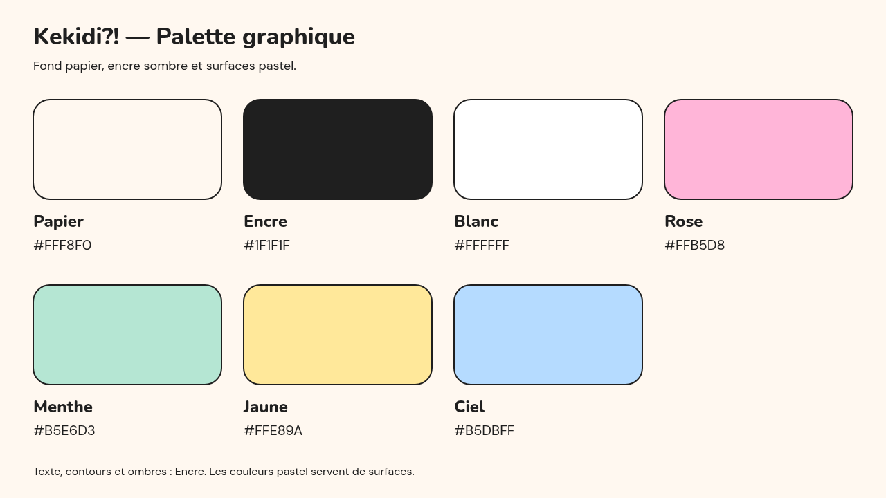

# Kekidi?! — Charte graphique

Une identité d’affiche citoyenne : lettres rondes, fond papier, couleurs pastel et contours francs. La lecture et les actions doivent rester immédiatement compréhensibles.

## Couleurs

Le Papier domine les pages. L’Encre sert aux textes et aux contours ; les pastels mettent en valeur les actions et les contenus.

| Couleur | HEX | Usage |
|---|---|---|
| Papier | `#FFF8F0` | Fond général |
| Encre | `#1F1F1F` | Textes, contours, ombres |
| Blanc | `#FFFFFF` | Cartes, boutons secondaires |
| Rose | `#FFB5D8` | Logo, affiche |
| Menthe | `#B5E6D3` | Boutons principaux, liens |
| Jaune | `#FFE89A` | Réponse courte, survol |
| Ciel | `#B5DBFF` | Badges de catégorie |

Sur les surfaces pastel, conserver un texte sombre. Les couleurs des badges distinguent les cartes sans attribuer un sens permanent à chaque catégorie.

## Polices et tailles

[Nunito sur Google Fonts](https://fonts.google.com/specimen/Nunito) donne aux titres leur caractère rond et affirmé. [DM Sans sur Google Fonts](https://fonts.google.com/specimen/DM+Sans) assure la lisibilité des textes et des commandes. Les liens du tableau donnent accès aux fichiers utilisés sur le site.

| Usage | Police | Taille web |
|---|---|---|
| Titres | [Nunito 800](assets/polices/nunito-extra-bold.ttf) | 24–80 px selon le titre |
| Réponse courte | [Nunito 800](assets/polices/nunito-extra-bold.ttf) | 40–72 px ; mobile : 40–56 px |
| Paragraphes | [DM Sans 400](assets/polices/dm-sans-regular.ttf) | 18 px, interligne 1,65 |
| Navigation et boutons | [DM Sans 600](assets/polices/dm-sans-semibold.ttf) | 14–15 px |
| Badges | [DM Sans 600](assets/polices/dm-sans-semibold.ttf) | 12 px |
| Légendes | [DM Sans 400](assets/polices/dm-sans-regular.ttf) | 13 px |

Aligner les paragraphes à gauche et laisser les titres revenir à la ligne. La réponse courte reste le texte dominant sur sa page.

## Composants

Réutiliser les mêmes formes, contours et ombres sur toutes les pages. Le bouton principal indique l’action à privilégier ; toute la carte de question est cliquable.

| Élément | Fond | Forme | Ombre |
|---|---|---|---|
| Bouton principal | Menthe | Pilule, hauteur ≥52 px | 5 px |
| Carte de question | Blanc | Rayon 24 px, entièrement cliquable | 5 px |
| Affiche d’accueil | Rose | Rayon 32 px, inclinée de 3° | 8 px |
| Réponse courte | Jaune | Rayon 32 px ; mobile : 24 px | 8 px |

**Contours :** 2 px Encre. **Ombres :** Encre, décalées à droite et en bas, sans flou.

Au survol, le bouton principal devient Jaune et se soulève légèrement. À l’appui, son ombre se réduit pour donner un effet de pression.

**Liens soulignés :** fond Menthe ; Jaune au survol ; Rose au clic. Après visite, seul le soulignement change de couleur. Focus clavier : contour Encre de 3 px.

## Mise en page

L’accueil présente les questions et l’affiche avec de larges espaces. Les pages de réponse utilisent une colonne plus étroite pour faciliter la lecture. Sur mobile, les éléments s’empilent et les boutons principaux peuvent prendre toute la largeur.

| Repère | Valeur |
|---|---|
| Espacements | 8, 16, 24, 32, 48, 80 px |
| Accueil | Largeur maximale 1 184 px ; 1 280 px sur grand écran |
| Page de réponse | Largeur maximale 820 px |
| Cartes | 3 colonnes ; 1 colonne à ≤800 px |
| Marges mobiles | 20 px |
| Entre deux paragraphes d’explication | 16 px |

## Règles

- Utiliser les logos fournis : le nom complet pour identifier Kekidi?!, le médaillon seul pour les petites icônes.
- Texte Encre sur fond clair. Conserver les proportions du logo.
- Pages de réponse droites. Affiche inclinée uniquement sur l’accueil : 3° ; mobile : 2°.
- Garder les liens soulignés et les zones cliquables d’au moins 44 px.

## Assets

Les PNG ont un fond transparent. Conserver le dossier `assets` à côté de ce document pour préserver les liens et les images lors du transfert.

- **Logo transparent :** [1 200 px](assets/logos/kekidi-wordmark-1200.png) · [600 px](assets/logos/kekidi-wordmark-600.png) · [300 px](assets/logos/kekidi-wordmark-300.png) · [SVG](assets/logos/kekidi-logo.svg)
- **Médaillon :** [512 px](assets/logos/kekidi-icon-512.png) · [192 px](assets/logos/kekidi-icon-192.png) · [180 px](assets/logos/kekidi-icon-180.png) · [64 px](assets/logos/kekidi-icon-64.png) · [32 px](assets/logos/kekidi-icon-32.png)
- **Médaillon SVG :** [Couleur](assets/logos/kekidi-medaillon-couleur.svg) · [Monochrome, sans fond](assets/logos/kekidi-medaillon-monochrome.svg) — mêmes formes que les PNG, signes convertis en tracés.
- **Nuancier :** [PNG](assets/couleurs/nuancier.png) · [SVG](assets/couleurs/nuancier.svg) · [Palette HEX/RGB en CSV](assets/couleurs/palette.csv)
- **Polices à télécharger :** [Nunito ExtraBold 800](assets/polices/nunito-extra-bold.ttf) · [DM Sans Regular 400](assets/polices/dm-sans-regular.ttf) · [DM Sans SemiBold 600](assets/polices/dm-sans-semibold.ttf)
- **Licences des polices :** [Nunito](assets/polices/nunito-LICENSE.txt) · [DM Sans](assets/polices/dm-sans-LICENSE.txt) — à conserver avec les fichiers.
